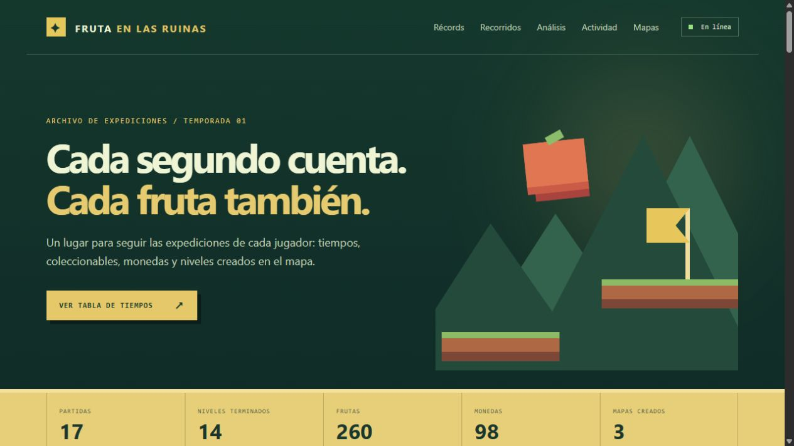
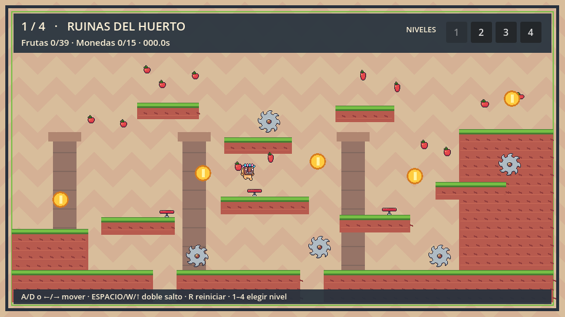
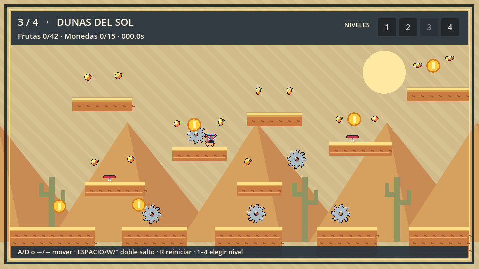

# Fruta en las Ruinas

Juego de plataformas en Godot 4 con cuatro mundos, modo historia, creador de mapas y tiempos guardados en SQL Server. La API y su panel web están en `backend/`.

## Capturas y videos

### Panel web

### Juego

Los videos de 30 segundos muestran el panel y las ayudas de salto:

- [Demostración de la web](docs/videos/web-demo.mp4)
- [Input buffering y coyote time](docs/videos/jump-assist.mp4)

Las composiciones reproducibles de HyperFrames están en [`docs/videos/source`](docs/videos/source) y siguen la identidad de [`docs/videos/DESIGN.md`](docs/videos/DESIGN.md). El video del salto es una secuencia explicativa con capturas y sprites reales del juego.

## Iniciar

Requisitos: **Godot 4.7**, **.NET 10 SDK** y **SQL Server**. El primer arranque de la API puede descargar el paquete NuGet `Microsoft.Data.SqlClient`.

1. Inicia la instancia local de SQL Server. Crea la base `DB` y un usuario SQL con permisos `db_datareader`, `db_datawriter` y `db_ddladmin` sobre ella. De forma predeterminada, el script usa el usuario `Codex` y la instancia local `lpc:.`. Puedes definir `SQL_SERVER`, `SQL_DATABASE` y `SQL_USER` en el entorno antes de iniciarlo si tu configuración es distinta.
2. Abre PowerShell en la raíz del proyecto y ejecuta `./run_backend.ps1`. Escribe la contraseña SQL cuando se solicite. El script la mantiene fuera del código y de los archivos del proyecto. Si ya definiste `SQL_PASSWORD` en el entorno, el script usará esa variable sin solicitarla.
3. Abre esta carpeta en Godot 4.7 y ejecuta `main.tscn` con **F5**.
4. El panel de datos se abre en [http://127.0.0.1:8000/](http://127.0.0.1:8000/). [La comprobación de conexión](http://127.0.0.1:8000/api/health) debe responder `database: connected`.

Si Windows PowerShell indica que la ejecución de scripts está deshabilitada, ejecuta `Set-ExecutionPolicy -Scope Process -ExecutionPolicy RemoteSigned` en **esa misma ventana** y luego repite `./run_backend.ps1`. El alcance `Process` dura solo hasta cerrar esa sesión de PowerShell; no modifica la política permanente del equipo.

La API escucha solo en la propia computadora. Mantén abierta la terminal mientras juegas. Si se interrumpe la conexión, las sesiones, eventos y tiempos pendientes quedan en `user://sql_sync_queue.json` y se reenvían al volver a iniciar el juego con la API disponible. El creador necesita la API activa para guardar o cargar mapas.

## Jugar y ver tiempos

Escribe el nombre del jugador en el menú y elige **Modo historia** o **Juego libre**. En Juego libre puedes elegir nivel con `1`–`4` o los botones superiores; el modo historia recorre los cuatro capítulos en orden. Muévete con `A/D` o flechas, salta con `Espacio`, `W` o `↑` (doble salto), reinicia con `R` y avanza tras la meta con `Enter` o el botón. El botón **Reintentar** reinicia el nivel y el cronómetro, incluso después de terminar el cuarto nivel. Volver al menú y empezar otra partida crea una sesión nueva con el nombre que esté escrito entonces.

El salto tiene **input buffering**: si pulsas salto hasta 0,12 s antes de aterrizar cuando ya no quedan saltos, se ejecuta al tocar el suelo. El **coyote time** conserva el salto de suelo durante 0,10 s después de abandonar una plataforma; pasado ese tiempo aún puedes usar el salto aéreo del doble salto. Al morir, reiniciar o rebotar en un trampolín se limpia cualquier salto pendiente. Cada salto ejecutado reproduce un sonido, y la cámara vibra brevemente al morir.

Cada mundo mide **2880 × 540**, tres pantallas de recorrido continuo con cámara, monedas, frutas, sierras y trampolines. Las temáticas son **Ruinas del huerto**, **Bosque esmeralda**, **Dunas del sol** y **Cumbres de cristal**. La historia del **Reloj Semilla** presenta un prólogo, una introducción y un cierre por capítulo, y un epílogo.

La **Tabla de tiempos** tiene dos categorías independientes por nivel:

- **Any%:** llegar a la meta con menos de todas las frutas, sean cero o algunas.
- **Todas las frutas:** llegar a la meta con todas las frutas de ese nivel.

Se guardan **todas** las llegadas en `dbo.LevelRuns`; cada tabla muestra los diez tiempos menores de ese nivel y categoría. El nombre procede de la sesión creada al iniciar la partida. SQL Server también guarda sesiones, intentos individuales, eventos de juego (inicio, saltos, posiciones periódicas, frutas, monedas, muertes, reapariciones, reinicios y finales) y mapas. La landing muestra estadísticas, actividad reciente, tiempos y mapas. Las pruebas de mapas creados registran actividad, pero no entran en las tablas oficiales.

En la página web puedes elegir un intento de un jugador y reproducir su recorrido sobre el mapa correspondiente, dibujado con los fondos y sprites del juego. La línea de tiempo conserva los eventos de muerte y reaparición dentro de la misma partida; el cronómetro sigue avanzando hasta llegar a la meta. Cada nuevo intento o reinicio queda como un recorrido separado. Los mapas de la comunidad se dibujan desde su geometría guardada en SQL Server, y las pruebas usan una copia del mapa en el momento de jugar para que las repeticiones no cambien si luego editas el original. Los récords antiguos siguen visibles, aunque no tienen animación si se registraron antes de esta función.

El panel **Análisis** muestra zonas con más muertes, los trampolines más usados y tiempos individuales por partida y agregados por mapa. Los nuevos rebotes guardan la posición del trampolín; los anteriores se asignan al más cercano cuando es posible. La gráfica de barras compara mapas por tiempo medio, mejor tiempo, partidas terminadas, muertes o rebotes; cada barra permite seleccionar su mapa y muestra cuántas partidas terminadas respaldan el tiempo. Solo las partidas completadas intervienen en los promedios y mejores tiempos; los intentos sin terminar conservan su duración individual. El selector de mapa filtra el análisis espacial y las partidas; la búsqueda de jugador filtra solo la tabla de partidas.

El archivo local antiguo `user://leaderboard.cfg` ya no alimenta estas tablas y no se migra automáticamente a SQL Server. Los registros nuevos sobreviven al cierre del juego en la base `DB`.

## Creador de mapas

Abre **Creador de mapas** desde el menú. Elige una herramienta y haz clic en el lienzo para colocar plataformas, frutas, monedas, sierras, trampolines, inicio o meta. Con **Seleccionar / mover** puedes arrastrar elementos; con clic derecho o **Borrar** los quitas. Cambia el tema entre ruinas, bosque, desierto y nieve. **Probar** abre el mapa jugable, **Guardar** lo almacena en `dbo.CustomMaps`, y la lista de la derecha permite cargarlo después. Al completar una prueba puedes volver al editor.

Los mapas creados en esta versión miden **960 × 540**. El editor es una escena de Godot con nodos visibles y seleccionables; su interfaz está en `scenes/map_maker.tscn`, su lógica en `scripts/map_maker.gd` y la escena jugable generada en `scenes/custom_level.tscn`.

## Editar desde Godot

Abre `main.tscn` y despliega `LevelCollection` para ver `Level01` a `Level04`. En cada uno, `Platforms`, `Fruits`, `Coins`, `Saws`, `Trampolines`, `Goal` y `Player/Camera2D` son nodos visibles en el árbol y en el visor. Bajo `Player` también están `JumpBufferTimer`, `CoyoteTimer` y `JumpSound`; cambia **Wait Time** en los temporizadores para ajustar las ventanas de salto, o las propiedades de `Camera2D` para variar la intensidad y duración de la sacudida. Abre `scenes/level_02.tscn`, por ejemplo, para editarlo sin superponer los demás. `scenes/hud.tscn`, `scenes/menu.tscn`, `scenes/story_panel.tscn` y `scenes/map_maker.tscn` contienen los controles de interfaz.

`scripts/world.gd` coordina escenas, cronómetro, recolección, intentos y flujo de pantallas; `scripts/player.gd` mueve al personaje; `scripts/levels.gd` define los cuatro recorridos; `scripts/story.gd` contiene el guion; `scripts/game_api.gd` sincroniza eventos, trayectorias y récords con la API. Las escenas de niveles se generan desde `scripts/levels.gd` mediante `tools/generate_level_scenes.gd`. Si modificas los datos de los recorridos, vuelve a ejecutar ese generador y `tools/export_level_layouts.gd` con Godot para actualizar el dibujo de la web en `backend/wwwroot/official_levels.json`. La prueba `tests/level_content.gd` comprueba que sus coordenadas coincidan.

## Reiniciar tiempos sin botón en el juego

Desde **SQL Server Management Studio**, selecciona la base `DB` y ejecuta el contenido de `backend/reset_leaderboard.sql`. También puedes ejecutarlo desde la raíz del proyecto con `sqlcmd -S lpc:. -d DB -U Codex -i .\backend\reset_leaderboard.sql`, introduciendo la contraseña cuando se solicite. El script borra solo `dbo.LevelRuns`; conserva jugadores, actividad y mapas. **No lo ejecutes si deseas conservar los tiempos.** El antiguo `tools/reset_leaderboard.gd` solo afecta al archivo local heredado y no reinicia SQL.

## Verificación

Con Godot en el PATH, `godot --headless --path . --script res://tests/level_content.gd` comprueba la estructura de niveles largos, monedas, cámaras y texto de historia. `godot --headless --path . --script res://tests/fruit_regression.gd` comprueba la recolección, los nombres y el flujo jugable sin escribir en SQL. `godot --headless --path . --script res://tests/jump_assist.gd` prueba el buffer, el coyote time, el doble salto y el rebote con colisiones reales; `godot --headless --path . --script res://tests/player_feedback.gd` comprueba el sonido y la sacudida al morir. `godot --headless --fixed-fps 60 --path . --script res://tests/level_routes.gd` recorre físicamente los cuatro niveles largos con saltos reales. Si `godot` no está en el PATH, usa la ruta absoluta de tu ejecutable de Godot. Para la API, `dotnet build .\backend\Platformer.Api.csproj` comprueba la compilación y `/api/health` comprueba la conexión a SQL. Consulta `backend/README.md` para el contrato JSON y la estructura de datos.

## Créditos de arte

Los sprites Pixel Adventure 1 y 2 son de [Pixel Frog](https://pixelfrog-assets.itch.io/), publicados bajo licencia CC0. El efecto de salto se generó para este proyecto.
